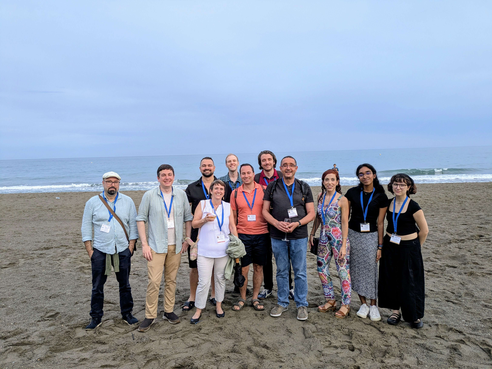
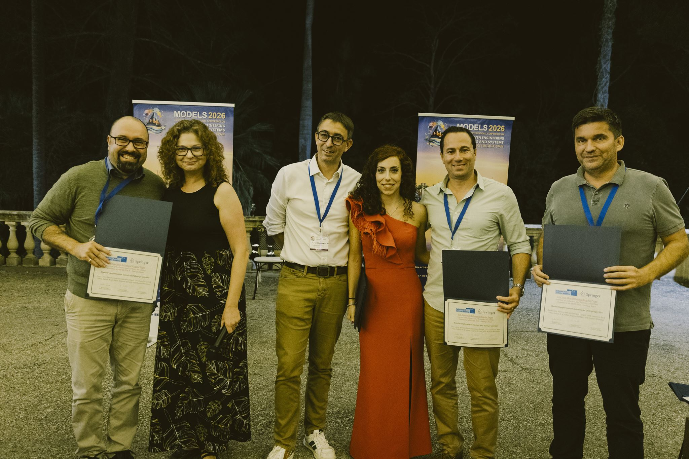
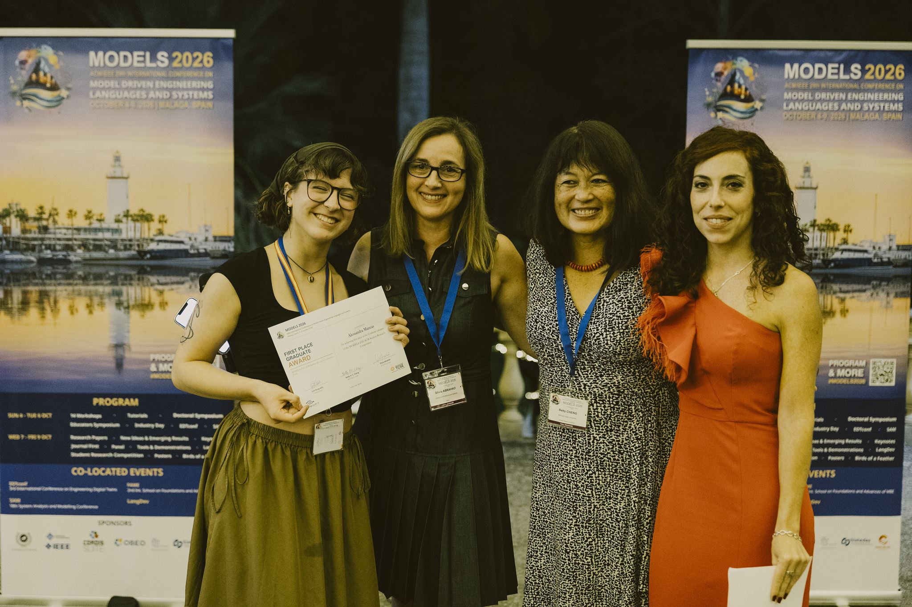

This October, [MODELS 2026](https://conf.researchr.org/home/models-2026) brought the model-driven engineering community to Málaga, Spain, from October 4 to 9. GEODES was represented throughout the week, from the co-located workshops and conferences to the main research program.

<!--more-->

## Rethinking consistency in collaborative modeling

The week started on Sunday with [Luciano Marchezan](https://lucianomarchezan.github.io/) presenting **[“Towards Rethinking Consistency Management in Collaborative Modeling Through Organizational Dimensions”](https://doi.org/10.1145/3837062.3838722)**, co-authored with Hyacinth Ali and [Eugene Syriani](https://recherche.umontreal.ca/english/our-researchers/professors-directory/researcher/is/in18930/). His presentation appeared in the [Models and Evolution workshop](https://models-and-evolution.github.io/speakers/).

The paper looks at consistency management from a perspective that goes beyond detecting and fixing differences between models. When people model together, the right strategy also depends on how their team works: who owns which artifacts, who can make decisions, and whether temporary inconsistencies are acceptable. The work proposes using these organizational dimensions to guide the choice of consistency-management strategies.

DOI: **[10.1145/3837062.3838722](https://doi.org/10.1145/3837062.3838722)**.

## A Model-Driven Formalization of Prompt Patterns

On Monday, [Vennila Sooben](https://vennilasooben.dev/) presented **[“A Model-Driven Formalization of Prompt Patterns”](https://doi.org/10.1145/3837062.3839377)**, co-authored with Eugene Syriani, at the [MDE Intelligence workshop](https://mde-intelligence.github.io/). Her contribution connected the workshop's two themes by applying model-driven engineering to the formal representation of prompt patterns.

DOI: **[10.1145/3837062.3839377](https://doi.org/10.1145/3837062.3839377)**.

## Digital twins for greenhouse crop production

MODELS week also included [EDTconf 2026, the International Conference on Engineering Digital Twins](https://conf.researchr.org/home/edtconf-2026). In its [SoSyM Journal Track](https://conf.researchr.org/track/edtconf-2026/edtconf-2026-journal-track), [Kevin Delcourt](https://kevindelcourt.github.io/) presented **[“Trans-Domain Digital Twins with Adaptive Intelligence for Optimizing Greenhouse Crop Production”](https://doi.org/10.1007/s10270-026-01434-1)**, co-authored with Mansoorali Amiri and [Houari Sahraoui](https://recherche.umontreal.ca/english/our-researchers/professors-directory/researcher/is/in15076/).

The paper brings together two closely connected parts of greenhouse farming: the plants and their environment. Its digital twin architecture connects crop and greenhouse models through synchronized co-simulation, while an alignment layer handles differences between the models. Simulations provide estimates of conditions that physical sensors cannot fully capture, and adaptive data-driven components support prediction and control. The goal is to move beyond isolated models toward a digital twin that represents how plant growth, microclimate, and control decisions affect one another.

The paper was published in **Software and Systems Modeling (SoSyM)** in September 2026. DOI: **[10.1007/s10270-026-01434-1](https://doi.org/10.1007/s10270-026-01434-1)**.

## Breaking Models to Test the Judge

Kevin also presented **[“Breaking Models to Test the Judge: A Mutation Testing Approach for Semantic Evaluators of Domain Class Diagrams”](https://doi.org/10.1145/3822455.3838768)** in the [New Ideas and Emerging Results (NIER) track](https://conf.researchr.org/track/models-2026/models-2026-nier). The paper was co-authored with [Meriem Ben Chaaben](https://meriembenchaaben.github.io/), Abdelhamid Rouatbi, Luciano Marchezan, and Houari Sahraoui.

The work asks a question that becomes increasingly important as LLMs are used to evaluate models: how do we test the evaluator? The approach deliberately introduces semantic errors into domain class diagrams and checks whether an LLM-based judge detects them. By comparing these mutation-based evaluations with manual assessments, the paper explores a more systematic way to assess the reliability of semantic judges.

DOI: **[10.1145/3822455.3838768](https://doi.org/10.1145/3822455.3838768)**.

## Towards Lightweight Domain Model Reverse Engineering from Source Code

In the main conference's [Research Papers track](https://conf.researchr.org/track/models-2026/models-2026-research-papers), [Alessandra Mancas](https://conf.researchr.org/profile/models-2026/alessandramancas) presented **[“Towards Lightweight Domain Model Reverse Engineering from Source Code”](https://doi.org/10.1145/3822455.3830329)**, co-authored with Mounir Ammam, Hyacinth Ali, Kevin Delcourt, and Houari Sahraoui.

The paper tackles a familiar reverse-engineering problem: source code contains many implementation details, but understanding a system often requires recovering the higher-level concepts of its domain. The approach combines structural and semantic heuristics with lightweight, open-source LLMs to identify those concepts and their relationships. Rather than feeding an entire codebase to a large model, it selects and processes relevant information incrementally, with local deployment and limited context windows in mind.

DOI: **[10.1145/3822455.3830329](https://doi.org/10.1145/3822455.3830329)**.

## Ten years of influence

The week also provided an opportunity to revisit research whose influence has lasted a decade. In the conference's [SoSyM awards session](https://conf.researchr.org/track/models-2026/models-2026-research-papers), Eugene Syriani presented **[“Model transformation intents and their properties”](https://doi.org/10.1007/s10270-014-0429-x)**, co-authored with Levi Lúcio, Moussa Amrani, Juergen Dingel, Leen Lambers, Rick Salay, Gehan M. K. Selim, and Manuel Wimmer.

The paper received the **[2026 SoSyM Ten Year Most Influential Regular Paper Award](https://www.sosym.org/awards/)**. It examines model transformations through their *intent*: what a transformation is meant to accomplish, and which properties it should satisfy to fulfill that purpose. This perspective provides a framework for reasoning about transformations beyond their individual implementations.

The paper appeared in **Software and Systems Modeling, Volume 15, Issue 3 (2016), pp. 647–684**. DOI: **[10.1007/s10270-014-0429-x](https://doi.org/10.1007/s10270-014-0429-x)**. Congratulations to Eugene and all his co-authors!

## A Student Research Competition

One of the highlights of the week for us was the [ACM Student Research Competition](https://conf.researchr.org/track/models-2026/models-2026-acm-student-research-competition). In addition to her main-track presentation, Alessandra presented **[“A Modular Framework for Conceptual Model Recovery from Source Code”](https://doi.org/10.1145/3837062.3839353)** in the graduate competition, taking part in both the [poster and presentation rounds](https://conf.researchr.org/details/models-2026/models-2026-acm-student-research-competition/4/A-Modular-Model-Driven-Reverse-Engineering-Framework-for-Conceptual-Model-Recovery).

Her project separates the extraction of implementation information from the recovery of higher-level meaning, using structured intermediate representations to connect the two. The framework is illustrated through domain model recovery and conceptual sequence diagram recovery, exploring how different reverse-engineering tasks can share a common approach.

**[Alessandra won 1st place!](https://www.linkedin.com/posts/houari-sahraoui-016740b_softwareengineering-modeldrivenengineering-activity-7514767037668270081-sBsy)** Following Imen Jaoua's first place at FSE 2026, this gives GEODES [two finalists in the ACM SRC Grand Finals](https://www.linkedin.com/posts/houari-sahraoui-016740b_softwareengineering-modeldrivenengineering-activity-7514767037668270081-sBsy). 

The SRC paper appears in the **MODELS 2026 Companion Proceedings**. DOI: **[10.1145/3837062.3839353](https://doi.org/10.1145/3837062.3839353)**.
